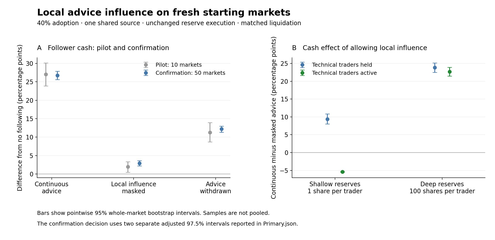

# Local influence raises follower cash gains on fresh starting markets

Both predeclared confirmation criteria passed. Across 50 fresh starting
markets, continuous shared advice gave followers a **26.706-percentage-point
cash advantage** after liquidation in the primary deep-reserve setting.
Masking followers' local influence reduced that advantage to **2.888 points**.
Allowing the local route therefore increased the advantage by **23.818 points**.
The confirmation supports the pilot's proposed mechanism within the specified
model and setting.

The campaign completed all **5,200 runs**, including 400 no-following controls,
with two design replicates per starting market. It used the unchanged repaired
execution engine. The primary setting retained 40% adoption of one shared
advice source, dealer reserves of 100 shares per trader, and technical traders
held. Each cash difference compares the same prospective follower cohort
against its own no-following market after identical liquidation, normalized
by each trader's value at adoption. No pilot observations entered the
confirmation estimates.

## The fixed confirmation decision

The [protocol](../../../docs/superpowers/specs/2026-09-14-reserve-transmission-confirmation.md)
was recorded before the fresh markets ran. It required positive lower
confidence limits for both endpoints below. Their two-sided 97.5% percentile
intervals apply a Bonferroni adjustment for nominal 95% coverage of the
two-endpoint family; bootstrap coverage is approximate. The analysis first
averaged the two design replicates within each market, then resampled whole
markets 10,000 times.

| Required endpoint | Mean change (percentage points) | Adjusted interval |
|---|---:|---:|
| Continuous-advice follower cash advantage | +26.706 | [+25.425, +28.062] |
| Continuous minus masked advice | +23.818 | [+22.304, +25.299] |

Both market-level means were positive in all 50 observed starting markets.
That observation does not establish positivity for every possible starting
market. The masked cash advantage had a pointwise 95% interval of
[+2.181, +3.584] points. Masking preserved follower submitted advice orders
and exactly restored held non-followers' no-following decision histories.
Completed trades could still differ because the surrounding market changed.

The ten-market pilot estimated a continuous-advice advantage of 27.008 points
and a continuous-minus-masked effect of 25.083 points. The fresh sample retained
both effects with somewhat smaller estimates. The samples are displayed
separately; this comparison is not an equivalence test.

Panel A compares the pilot and confirmation with deep reserves and technical
traders held. Panel B compares the confirmation's continuous-minus-masked
effects across both reserve levels and technical-trader conditions. Figure
bars are pointwise 95% intervals; the adjusted confirmation intervals are
reported in the table above.

## Where the conclusion applies

Deep reserves also retained a follower cash advantage with technical traders
active. Shallow reserves retained losses under continuous shared advice.
Moreover, allowing local influence increased the cash outcome with technical
traders held but reduced it with technical traders active at shallow reserves.
The following comparisons use the same 40% adoption of one shared source;
their intervals are secondary, pointwise 95% intervals.

| Technical traders | Reserve shares/trader | Continuous-advice cash advantage (pp) | Continuous minus masked advice (pp) |
|---|---:|---:|---:|
| held | 100 | +26.706 [+25.580, +27.875] | +23.818 [+22.518, +25.102] |
| active | 100 | +20.141 [+19.052, +21.255] | +22.702 [+21.482, +23.918] |
| held | 1 | −3.122 [−4.419, −1.808] | +9.396 [+8.019, +10.857] |
| active | 1 | −18.082 [−18.321, −17.847] | −5.374 [−5.493, −5.252] |

With deep reserves and technical traders held, withdrawing advice after
1,000 intervention steps reduced the follower cash advantage to 12.187 points
[11.347, 12.992]. Non-followers still spent an extra 22.831 percentage points
of trader-time selling during the final 500 steps [16.711, 29.203], relative
to their no-following histories. This supports persistence over the tested
period, without establishing permanent instability. Withdrawal also changes
follower orders, so it does not independently isolate local influence.

After matched liquidation, followers in the primary continuous-advice
condition collectively received about 905,765 additional currency units per
market on average, and the remaining traders lost the same amount within
numerical precision. Every trader share was liquidated in both arms. Across
all runs, the largest absolute dealer cash difference was 6.56e-7 currency
units and the largest aggregate trader cash difference was 1.13e-7. The
cohort advantage redistributed cash among traders.

## Verification and remaining scope

The [verification](verification.json) passed complete manifest and checkpoint
coverage, source/environment/analysis hashes, and recomputation of all
deposited estimates. It checked 800 exact held masking histories, 1,600
identical-advice comparisons, and 1,600 withdrawal-prefix comparisons.
The freshness audit found no seed overlap with 122 prior starting-market
seeds across 38 archived and repaired files, and no overlap with their saved
starting-state fingerprints. The smoke sample was excluded. All 19 new Julia
test assertions and three Python analysis tests passed before launch.

The [complete report](report.md), [primary decision](Primary.json),
[market-level values](Primary-markets.csv), and full CSV tables preserve
the specified settings, including 10% adoption and independent advice.
The executed source and protocol are archived in
`../../recovery/20260914-transmission-confirmation-v1-executed-source/`.

The fresh-market result supports local influence as a cause of the follower
cash advantage in the primary repaired-model setting. It does not establish
useful information about an external asset value, real investment performance,
or a universal benefit from shared advice. Copying, transaction costs,
alternative execution mechanisms, and size/horizon sensitivity remain
untested by this confirmation. The existing manuscript still needs revision
to distinguish the repaired results from the archived financial model.
