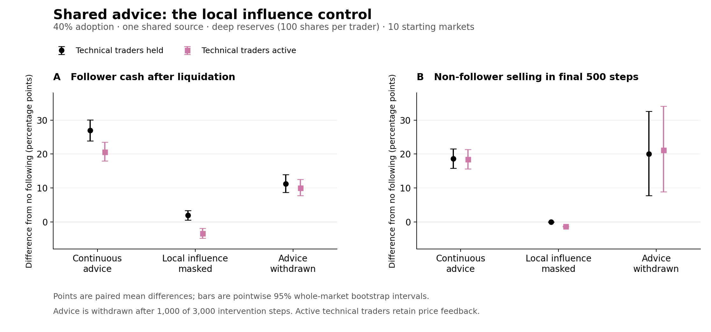

# Local influence raises follower cash gains in the repaired pilot

Allowing followers' decisions to enter their neighbors' local rules raises
the follower cash advantage in the primary deep-reserve experiment. Removing
that route reduces the advantage from **27.008 to 1.925 percentage points**,
despite identical follower submitted orders. The paired reduction is
**25.083 points**, with a pointwise 95% whole-market bootstrap interval of
**22.032 to 27.861**. These are differences from the same prospective cohort
in its no-following market, after identical liquidation.

This is the specified follow-up to the ten-market repaired pilot: 1,040
runs, including 80 no-following controls, with two design replicates per
starting market. The primary setting has 40% of interior traders following
one shared advice source, dealer reserves of 100 shares per trader, and
technical traders held fixed. It reuses the pilot markets and is exploratory.
The [protocol](../../../docs/superpowers/specs/2026-09-14-reserve-transmission-controls.md)
was recorded before the controls ran.

## The comparison that isolates local influence

Masking replaces a follower's state only when a non-follower reads that
neighbor during its local decision update. Followers keep their original
advice streams and still trade with their actual books. With technical
traders held, every non-follower then follows its original no-following
decision history. Different completed trades can follow from the changed
market, even though follower submitted orders are identical.

| Technical traders | Advice intervention | Follower exit-cash difference (pp; 95% interval) |
|---|---|---:|
| held | continuous | +27.008 [+23.874, +30.082] |
| held | local influence masked | +1.925 [+0.497, +3.319] |
| held | withdrawn after 1,000 steps | +11.238 [+8.711, +13.927] |
| active | continuous | +20.640 [+17.957, +23.475] |
| active | local influence masked | −3.391 [−4.844, −1.892] |
| active | withdrawn after 1,000 steps | +9.993 [+7.714, +12.488] |

All rows use deep reserves and 40% adoption of one source. With technical
traders active, masking reduces exit cash by 24.031 points [21.267, 26.700].
That control removes the direct local route, while the route through prices
and technical traders remains available. With held technical traders, the
shared-source advantage over independent advice changes from +22.122 points
under continuous advice to −2.291 when local influence is masked. Thus the
advantage of sharing a source also depends on the local response in this
setting. These contrasts are intervention effects within this model, not
general mediation fractions or evidence that the advice contains useful
information about an external asset value.

## Withdrawal and cash attribution

Stopping advice after the first 1,000 intervention steps reduces follower
exit cash but does not erase the observed excess selling over the remaining
2,000 steps. With technical traders held, non-followers still spend an extra
20.027 percentage points of trader-time selling in the final 500 steps
[7.739, 32.591], relative to their no-following histories. With active
technical traders, the corresponding change is 21.118 points [8.921, 34.136].
The uncertainty is wider than under continuous advice. These observations
establish persistence over the tested period; they do not establish permanent
instability. Withdrawal also changes followers' orders, so it is not a
second isolated test of local transmission.

The cash advantage is funded by other traders after matched liquidation.
In the primary continuous-advice setting, followers collectively receive
916,504.774 additional currency units on average and all remaining traders
lose the same amount. The dealer's final inventory and cash agree between
paired arms, as the reserve invariant predicts. Across all 1,040 runs, the
largest absolute dealer cash difference is 5.44e-7 units and the largest
aggregate trader cash difference is 8.52e-8 units. This closes the accounting
explanation for the cohort advantage under this exit scenario.

## Verification and scope

All 120 new control/ledger test assertions passed. The completed campaign
also passed 160 exact held-mask history comparisons, 320 identical-advice
checks, and 320 withdrawal-prefix comparisons. Every trader share was
liquidated in both arms. All 320 continuous-advice treatments reproduce the
earlier repaired pilot's common recorded outcomes exactly. Source, environment,
specification, manifest, checkpoint, and analysis hashes passed
[verification](verification.json).

The [complete report](report.md) and CSVs include both adoption fractions,
shared/independent advice, both reserve levels, both technical-trader
conditions, and every specified contrast. The favorable deep-reserve result
does not establish a universal follower gain: the shallow-reserve comparison
still includes losses and different masking effects. The new controls cover
advice; copying, transaction costs, alternative market mechanisms, and
size/horizon sensitivities remain outside this campaign. Confirmation on
fresh starting markets is the next validation step before strengthening
paper-level claims.
